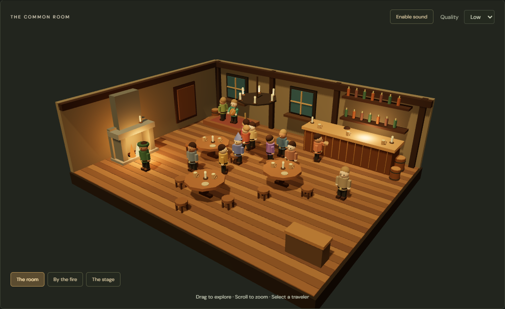

# LiveTabern

A persistent, shared 3D fantasy tavern for the web. Watch fifteen travelers drink, trade, talk, rest, dance, and make music while their history continues between visits.



## Run locally

Use Node.js 22.19 or newer and npm.

```sh
npm ci
npm run dev
```

Open **http://127.0.0.1:5173**. The frontend uses port 5173 and the world server uses port 3001. Keep the process running; closing the browser does not pause the world. Ctrl+C stops both services.

No model API keys or paid services are required. External AI is off.

Drag to orbit, scroll to zoom, and select a traveler or their card. Try the fireside and stage cameras, follow a character, filter the chronicle, or read earlier events. Sound is opt-in. Low graphics quality and reduced motion are available.

## Persistence and administration

The local world is stored in `.local/world.sqlite`, outside Git. Restarting restores confirmed progress, including identities, inventories, memories, and relationships. Recovery replays at most five minutes of downtime and explicitly records longer skipped intervals; the server must be running for continuous simulation.

For protected administration, copy `.env.example` to `.env`, set a long random `ADMIN_TOKEN`, and restart the server. Open http://127.0.0.1:5173/admin and enter that token. Metrics and director/capability controls require it. Tokens are not stored in browser local storage or URLs.

After building, `npm start` serves the built frontend and world together at http://127.0.0.1:3001. It binds to loopback; this is a local launch, not a public deployment.

## Verify

```sh
npm run lint
npm run format:check
npm run build
npm test
npx playwright install chromium
npm run test:e2e
npm audit
```

Browser tests reuse a local development server or start an isolated test world when one is absent. `npm test` includes a seven-day accelerated simulation, persistence checks, and a server restart/reconnection test using temporary databases.

The project intentionally omits undeclared peer packages via `.npmrc`; required React, Three.js, Express, and Colyseus dependencies are declared explicitly. This avoids unused authentication and monitoring integrations. The lockfile pins installed versions.

## Scope

This is a working **local MVP**, with procedural art and deterministic social behavior. It is not a publicly hosted 24/7 service. Production PostgreSQL, richer story arcs and bands, generative dialogue, and automated capability PR generation remain future work. The renderer still has a large lazy-loaded Three.js bundle; browser correctness tests are not hardware FPS guarantees.

See [implementation and acceptance evidence](docs/PROGRESS.md), [the backlog](planning/backlog.json), [architecture decisions](docs/ADR/001-local-persistence.md), and [agent instructions](AGENTS.md).
